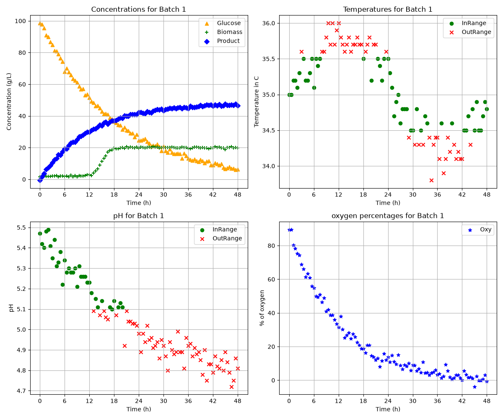

# Monitoring of fermentation bioprocess
Python code used to analyze datasets presenting variables such as pH and temperature from a fermentation process 
Objectives: The main goal was to present large datasets to show trends in terms of pH, concentrations(biomass, final product,glucose), oxygen percentage and temperatures and how they vary with time by batch number

Features 

-The code analyzes the dataset by batch_id number 
-It analyses whether the temperatures and pH fall within the acceptable range for each batch, each batch have their own limits
-It then generates figures for each batch_id and presents the in range and out of range data (and their evolution with time) using different colors and symbols
-It also presents figures where concentrations of glucose, final product, biomass and oxygen% are plotted against time so that their evolution can be evaluated 
-It generates for each batch_id a summary table presenting the percentage of datapoints within the desired ranges of temperature and pH as well as the final product concentration 

Technologies used

python 3.14.7
numpy 2.5.2
pandas 3.0.5
matplotlib=3.11.0

Code design

After running main.py: 
-the class extracts the batch numbers from the dataset
-It then compares each temperature and pH to their respective limits
-Then it identifies how many unique batch numbers there are
-it then creates a 2*2 figure with:
-at the top left a figure of Glucose, biomass, and product concentrations versus time
-at the top right a figure of Temperature versus time
-at the bottom left a figure of pH plotted against time
-at the bottom right dissolved oxygen percentage against time
-then the figures are exported and saved in figures
-Afterwards, a summary table with each batch_id is exported in tables it presents the percentage in each_id of the temperatures and pH falling within the prescribed range as well as their final product concentration

Dashboard

Figure Batch_001_Mode_B: at the top left corner Glucose(orange triangles), biomass(green +), and product concentrations (blue losanges) in g/L versus time in h. The concentration of glucose decreases, the concentration of biomass increases and then plateaus the product concentration increases. At the top right a figure of Temperature versus time with in-range temperatures represented by green circles and out of range temperatures represented by red crosses. At the bottom left a figure of pH versus time with in-range pH represented by green circles and out of range pH represented by red crosses. Finally at the bottom right dissolved oxygen percentage against time represented by blue stars.

Summary table: 
Table Summary_Mode_A: this table presents the percentage of pH and temperature within the optimal range for each batch_id as well as the final product concentration in g/L. Ex: in batch ID 4 100% of the pH datapoints were within the range and 96% of the temperatures were within the acceptable range, the final product concentration was of 48.6 g/L. 

| batch_id | ph_optimal_percent | temperature_optimal_percent | C_product_g_L^-1_final |
| :--- | :--- | :--- | :--- |
| 1 | 93.81 | 97.94 | 46.5 |
| 2 | 96.69 | 97.52 | 50.8 |
| 3 | 95.89 | 93.15 | 44.6 |
| 4 | 100.0 | 96.47 | 48.6 |
| 5 | 48.62 | 99.08 | 24.7 |